# SweetHome

## What is SweetHome?

SweetHome is a housing policy simulation prototype for South Korea. It helps policymakers explore how a proposed rule could affect different regions and households before putting it into practice. Individuals can also use it to understand changes in borrowing limits and housing affordability.

Upload a policy document, review the extracted changes, and compare scenarios on a regional map. Inspect the underlying assumptions, source quotations, and calculation steps. An editable knowledge graph connects policies, evidence, regions, and households so users can examine the relationships behind each scenario.

## Why does it matter?

Housing policies can change who can borrow, where people can afford to live, and when housing becomes available. The same rule may affect a first-time buyer, a homeowner planning to move, and a landlord differently. A policy intended to stabilize one area may also shift demand elsewhere.

SweetHome makes these trade-offs easier to discuss before a decision is made. It brings policy documents, public data, and research evidence into one place, helping users ask: **Who is affected, through which mechanism, and under what assumptions?**

This is a hackathon research prototype, not a validated house-price forecasting system. Public observations are kept separate from synthetic demonstration results. New policy experiments use reviewed inputs and explicit formulas; price sensitivities depend on user assumptions. Policy coverage is incomplete, and results should not be treated as investment advice or guaranteed outcomes.

## Presentation

[Download the PowerPoint](apps/web/public/pitch/SweetHome_final_pitch_v3_EN.pptx). In the running app, use the **Presentation** button to open the interactive slide viewer.

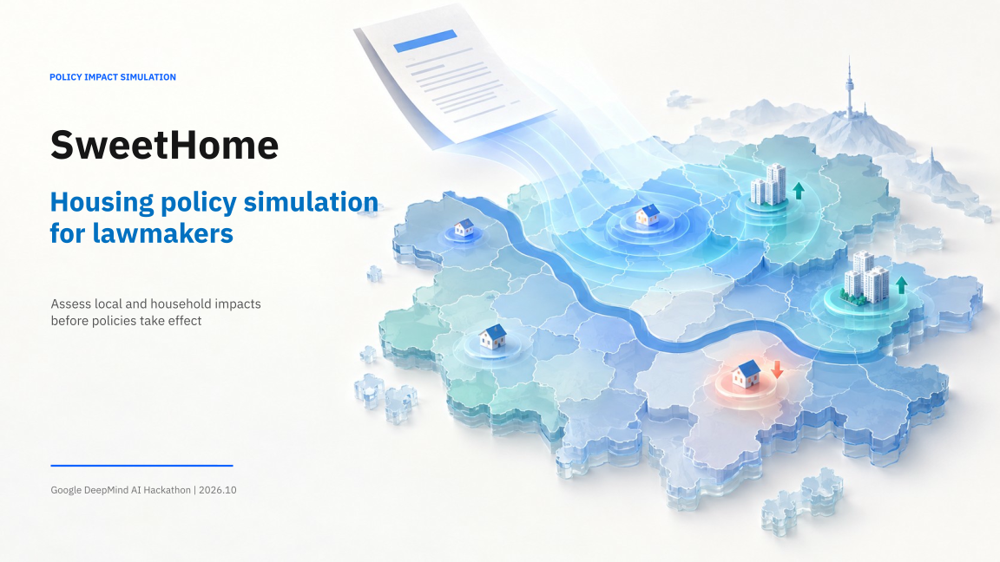


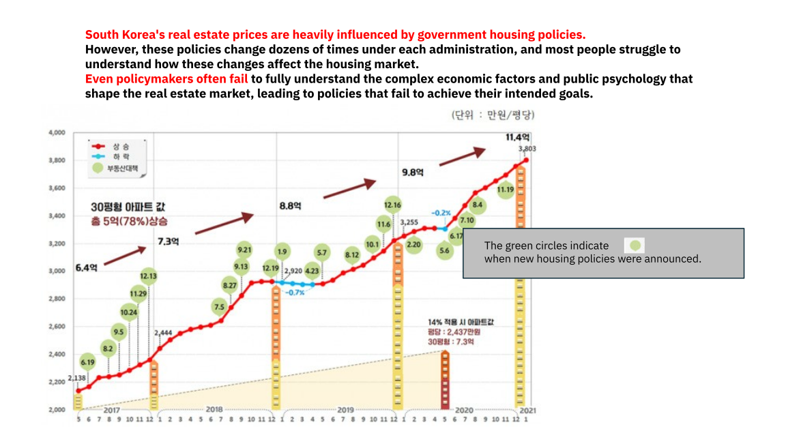

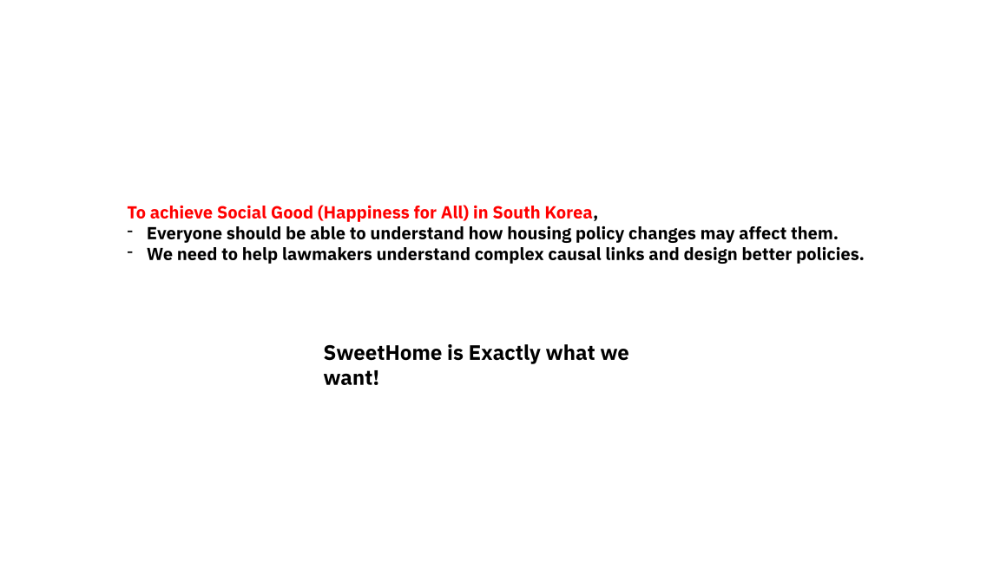

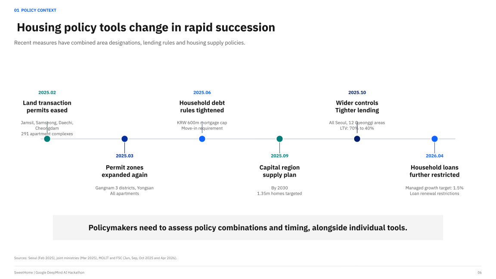

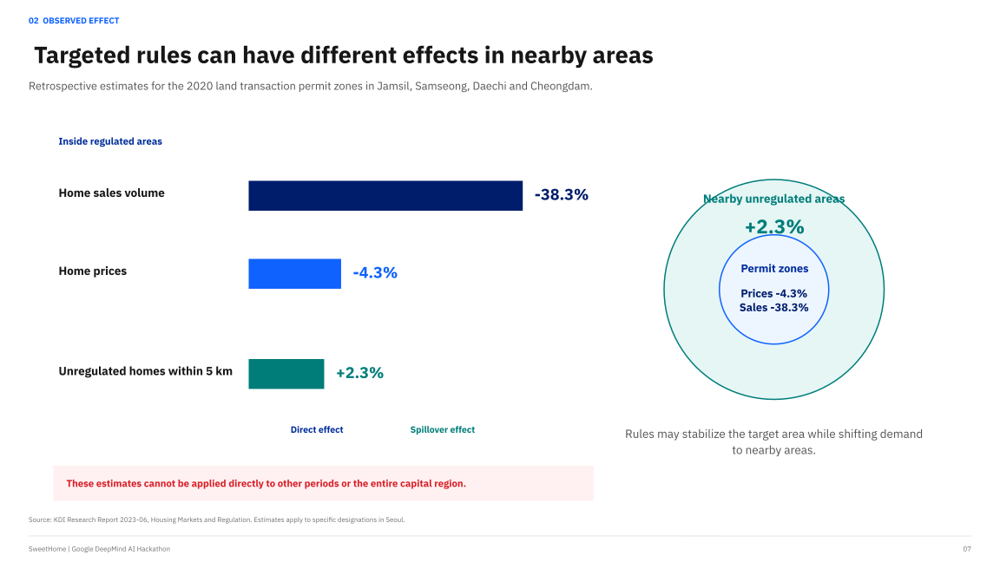

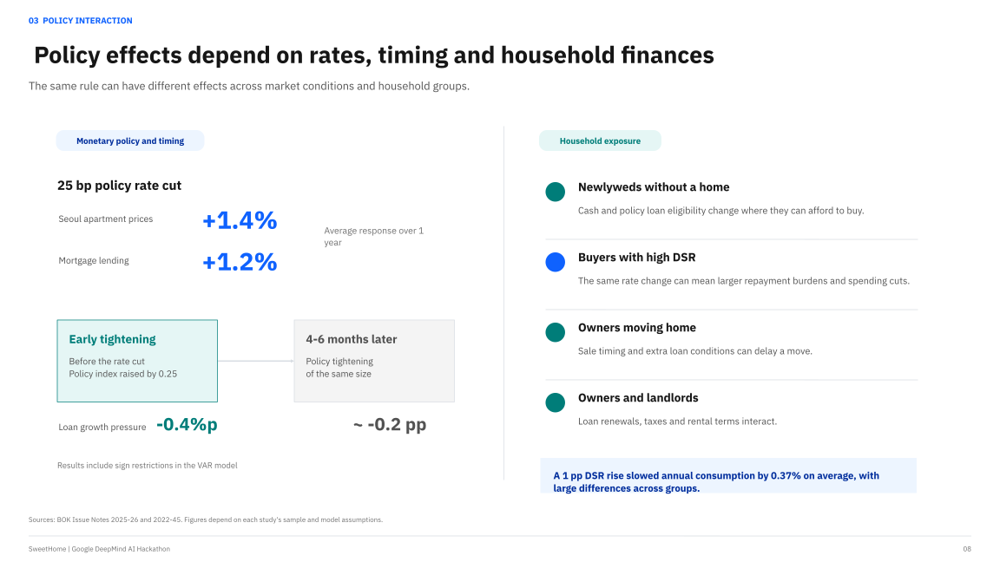

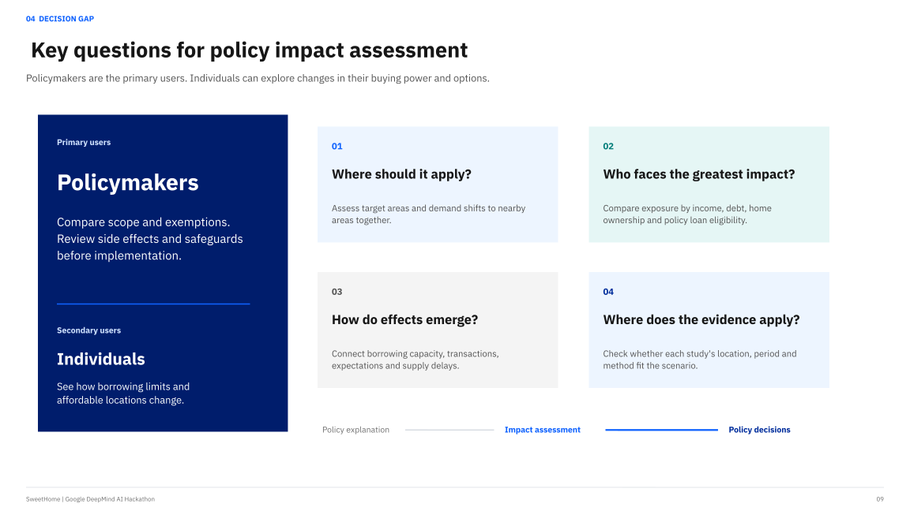

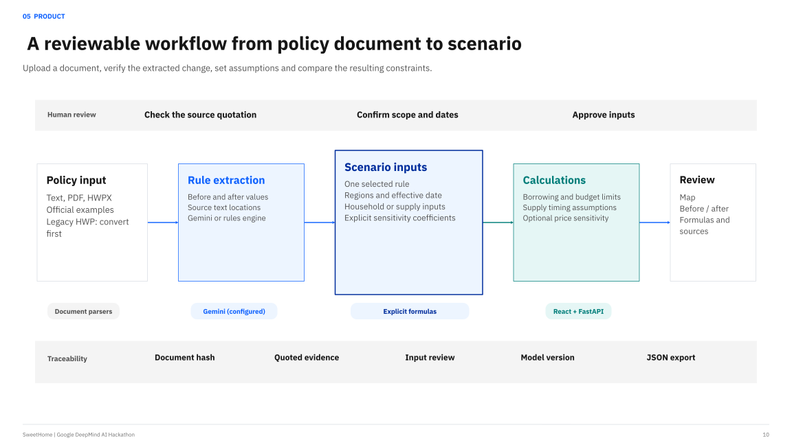

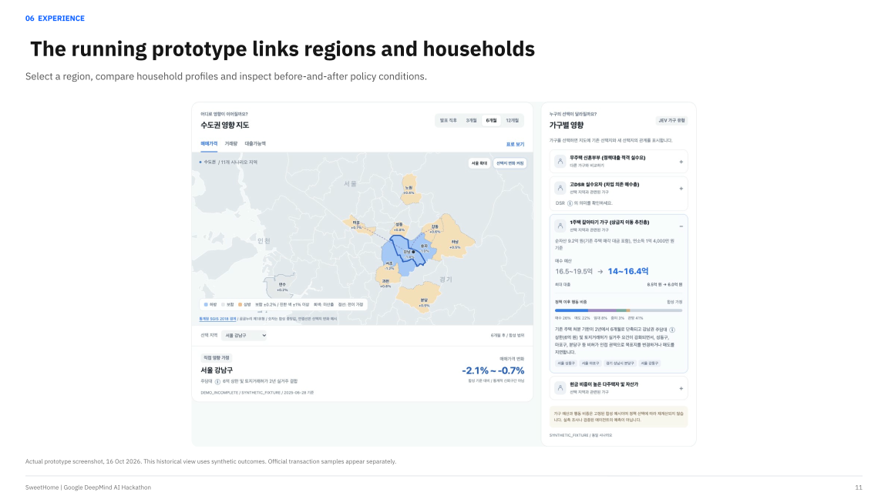

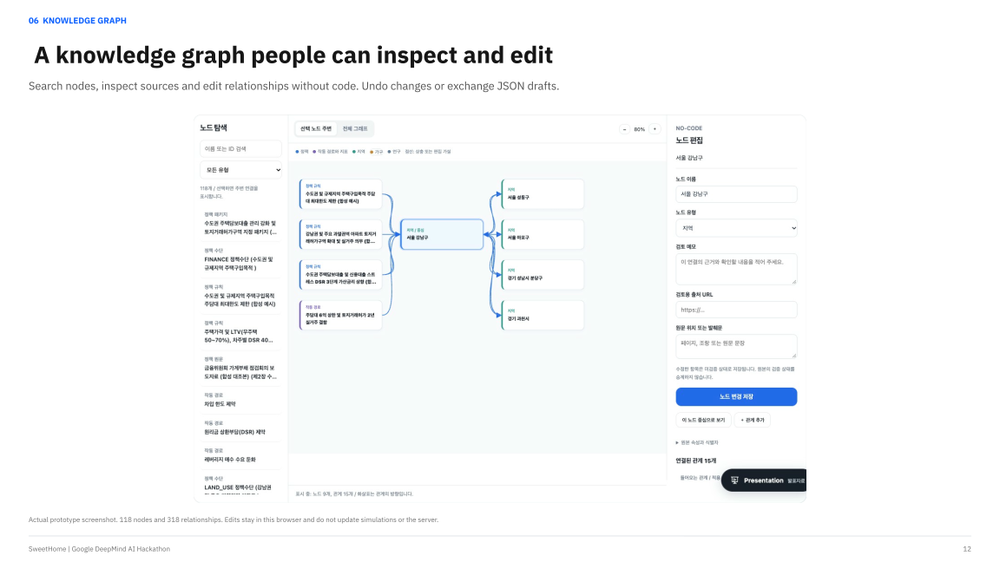

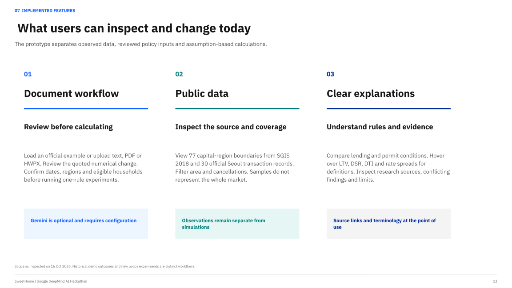

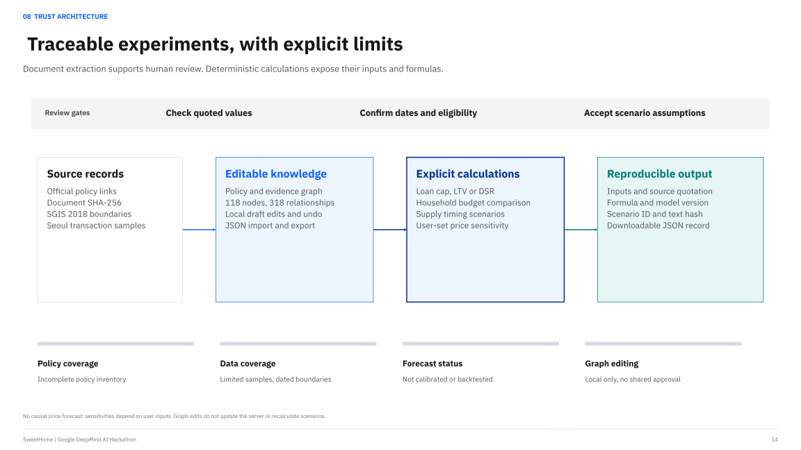

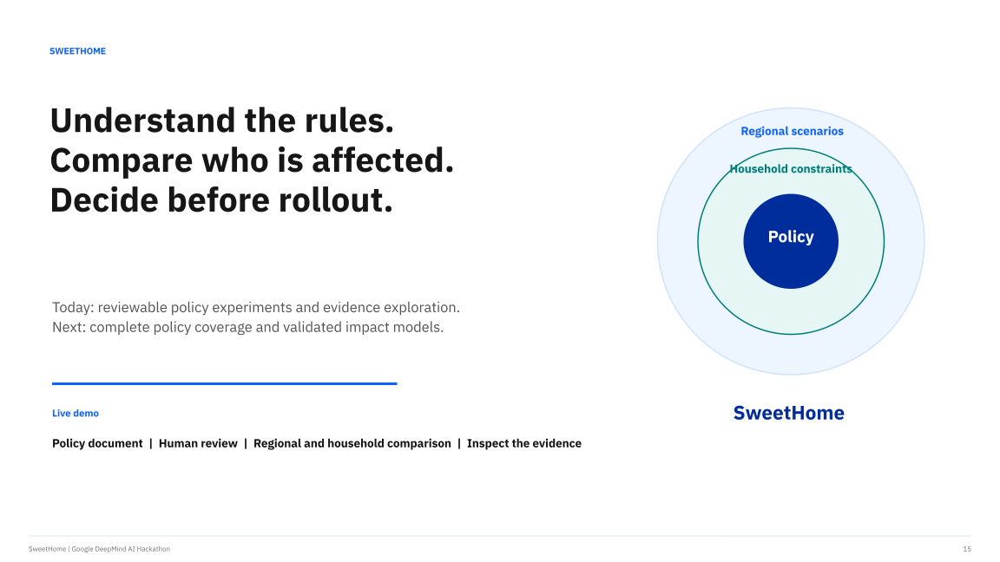

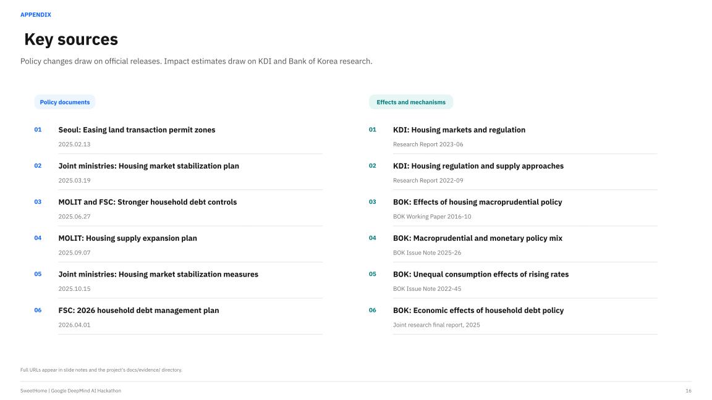

<details>
<summary>Run locally and explore the documentation</summary>

### Quick start

Install Node.js 20+, Python 3.12+, and `uv`. Docker is required only for container builds.

```bash
make setup
make dev
```

Default addresses are [the web app](http://localhost:5173), [API documentation](http://localhost:8000/docs), and [the health endpoint](http://localhost:8000/health). Check the terminal output if a port is already in use. Stop the development server with `Ctrl+C`.

### Configuration

Use `.env.example` as the starting point for `.env.local`. Never commit secrets. The demo runs without a Gemini API key. To enable model-based document extraction, configure `GEMINI_API_KEY` and a `GEMINI_MODEL` your account can access in the API process. See the [policy pipeline guide](docs/POLICY_PIPELINE.md) for loading these variables and supported document formats.

### Checks

```bash
make check
make test
make build
```

`make check` runs backend linting and tests, frontend tests and type checking, the web build, and fixture validation. `make test` runs backend and frontend tests. `make build` builds the web app and container images and requires a running Docker daemon.

### Repository

- `apps/web/`: React interface.
- `services/api/`: FastAPI, document analysis, and scenario calculations.
- `packages/contracts/`: Policy, evidence, and scenario schemas.
- `data/fixtures/`: Synthetic demonstration data.
- `data/public/`: Public observations, boundaries, and source metadata.
- `docs/`: Product, technical, and research documentation.
- `infra/cloudrun/`: Google Cloud deployment configuration.
- `scripts/`: Development, validation, and presentation export tools.

For Antigravity development, open this repository and read `GEMINI.md`, `.agents/rules/`, and `.agents/skills/` before changing the implementation.

### Documentation

Most detailed project documents are currently in Korean.

- [Policy document extraction and conditional scenarios](docs/POLICY_PIPELINE.md)
- [Financial glossary and contextual help](docs/GLOSSARY.md)
- [Knowledge graph exploration and no-code editing](docs/GRAPH_EDITOR.md)
- [Public data sources and coverage](data/public/README.md)
- [UI and public data handoff](docs/UI_DATA_HANDOFF.md)
- [Product specification](docs/PRODUCT_SPEC.md)
- [System architecture](docs/ARCHITECTURE.md)
- [Data model](docs/DATA_MODEL.md)
- [Research evidence library](docs/evidence/README.md)
- [Development backlog](docs/BACKLOG.md)
- [Demo guide](docs/DEMO.md)
- [Final demo plan](docs/FINAL_DEMO.md)
- [Decision records](docs/DECISIONS.md)
- [Web presentation](docs/WEB_PITCH.md)

</details>
