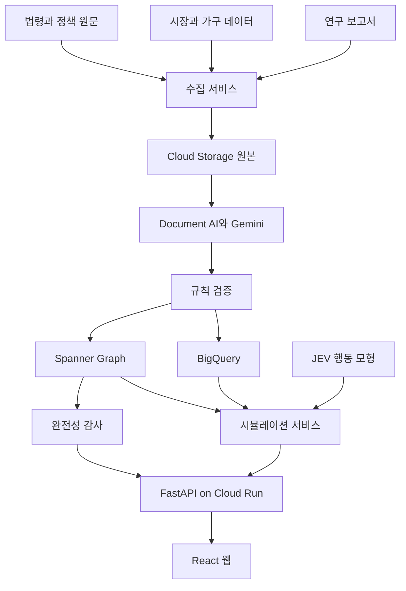
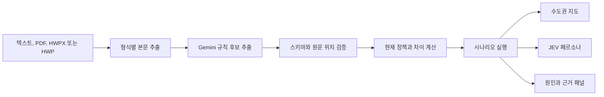
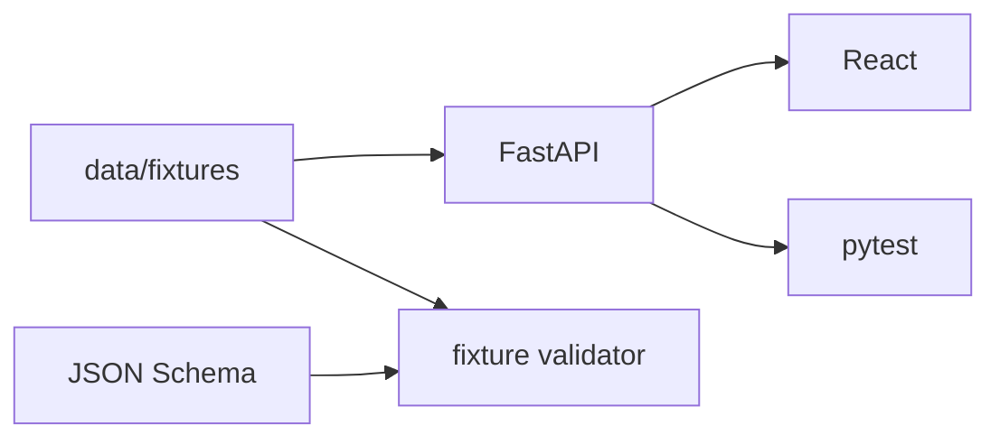

# 시스템 아키텍처

## 1. 구성 원칙

- 정책 원장과 시장 관측 데이터를 분리한다.
- 원문은 변경하지 않고 저장하며 구조화 결과에는 원문 위치를 연결한다.
- 지식 그래프는 관계를 탐색하고 BigQuery는 분석 데이터를 처리한다.
- LLM 추출 결과는 검증을 거친 뒤에만 정책 원장에 반영한다.
- API 응답은 데이터와 모델 상태를 항상 포함한다.
- 데모와 운영 모드를 명시적으로 분리한다.

## 2. 논리 구성



### 발표용 문서 입력 경로



- 텍스트는 바로 입력하고 PDF는 Document AI 또는 텍스트 추출기로 처리한다.
- HWPX는 문서 내부 XML을 읽는 어댑터를 사용한다.
- HWP는 전용 변환 어댑터를 사용하되, 추출 실패를 숨기지 않고 PDF 또는 텍스트 입력으로 전환한다.
- 원문 파일, 추출 텍스트, 문서 해시와 원문 위치를 함께 저장한다.
- 지도와 페르소나는 동일한 `scenario_id`, 데이터 버전과 모형 버전을 사용한다.
- 발표용으로 사전 계산한 결과를 사용하면 API 메타데이터와 화면에 캐시 상태를 표시한다.

## 3. 현재 하네스

현재 코드는 외부 서비스 없이 합성 fixture로 실행한다.



API는 실제 예측을 수행하지 않는다. 샘플 응답에는 다음 메타데이터가 포함된다.

- `data_status: DEMO_INCOMPLETE`
- `model_status: SYNTHETIC_FIXTURE`
- `is_investment_advice: false`
- fixture와 계약 버전

## 4. 서비스 경계

### 웹

- 정책 시나리오 입력과 결과 탐색을 담당한다.
- API가 제공한 값만 표시한다.
- 신뢰도와 데모 경고를 숨기지 않는다.
- 가격 계산이나 정책 적용 판정을 수행하지 않는다.

### API

- 정책 상태, 그래프, 완전성과 시나리오 API를 제공한다.
- 입력을 Pydantic으로 검증한다.
- fixture 또는 저장소 접근을 추상화한다.
- 시뮬레이션 실행 메타데이터를 생성한다.

### 계약

- 서비스 사이에서 사용하는 안정적인 데이터 구조를 정의한다.
- JSON Schema를 기준으로 fixture와 외부 수집 결과를 검사한다.
- 필드 삭제나 의미 변경은 계약 버전을 올린다.

## 5. 목표 GCP 구성

| 요구 | 서비스 후보 |
| --- | --- |
| 정적 원문과 첨부파일 | Cloud Storage |
| 이벤트 전달 | Pub/Sub |
| 수집 일정 | Cloud Scheduler, Workflows |
| 문서 구조 추출 | Document AI |
| 정책 규칙 추출과 설명 | Gemini 4 Argon |
| 정책 및 근거 그래프 | Spanner Graph |
| 관측 및 학습 데이터 | BigQuery |
| API와 웹 배포 | Cloud Run |
| 비밀 | Secret Manager |
| 로그와 감사 | Cloud Logging, BigQuery |

## 6. 단계별 교체 지점

### FixtureRepository에서 실제 저장소로 전환

API 라우터는 fixture 파일을 직접 읽지 않고 저장소 인터페이스를 사용한다. 다음 구현을 순서대로 추가한다.

1. `FixtureRepository`
2. `BigQueryObservationRepository`
3. `SpannerPolicyGraphRepository`

### 합성 결과에서 검증된 모형으로 전환

1. `FixtureScenarioEngine`
2. 금융 및 세금 결정식
3. 정책별 검증된 효과 모듈
4. JEV 행동 모형
5. 공간과 시간 반응 모형
6. 불확실성 보정

## 7. 배포 원칙

- 웹과 API는 독립된 Cloud Run 서비스로 배포한다.
- API만 데이터 저장소와 모델에 접근한다.
- 웹에는 서버 비밀값을 전달하지 않는다.
- 배포 이미지에는 fixture가 포함될 수 있지만 운영 모드에서는 fixture 응답을 차단한다.
- 리전은 행사 계정의 허용 범위를 따르며 기본 예시는 `asia-northeast3`이다.

## 8. 관측 가능성

각 요청에 다음 값을 기록한다.

```text
request_id
scenario_id
policy_snapshot_id
contract_version
data_version
model_version
data_status
model_status
duration_ms
```

문서 입력 요청에는 다음 값도 기록한다.

```text
document_id
document_format
document_hash
extraction_status
extraction_version
cache_status
```

정책 원문이나 사용자의 자연어 입력 전문을 로그에 남기기 전에 개인정보와 민감정보를 제거한다.
