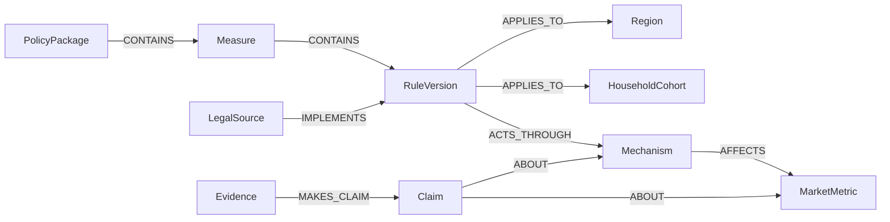

# 데이터 모델

## 가구 시나리오 재계산 (2026-10-16)

과거 정책 실험은 선택한 규칙의 시행일과 비교 기간을 확인한 뒤 가구별 적용 규칙을 다시 계산한다. 가구의 매수 예산과 행동 비중은 기존 합성 자료의 정책 적용 전 값과 전체 적용 후 값 사이를 보간한다. 가중치는 해당 가구에 적용되는 변경 규칙 중 선택한 규칙의 비율과 기간 계수를 곱한 값이다. 대출 한도는 금융 규칙 선택에 따라, DSR은 스트레스 DSR 선택에 따라 별도로 바뀐다. 규칙을 모두 해제하면 가구 결과와 지역 가격 변화는 기준 상태로 돌아간다.

이 계산은 정책 선택에 반응하는 합성 민감도이며, 규칙별 독립 효과를 추정하거나 실측 가구의 행동 확률을 예측한 결과는 아니다. 원본 기준값과 가중치는 응답에 유지한다.

## 서울 전 지역 연결 (2026-10-16)

서울 25개 자치구를 국가 시군구 코드로 경계, 지역 선택, 지식 그래프와 새 정책 입력에 연결한다. 기존 수도권 4개 지역을 포함한 선택 가능 지역은 29개다. 지식 그래프에서는 서울특별시 노드가 25개 자치구를 CONTAINS 관계로 연결한다.

`RegionResult.coverage_status`는 기존 수치 시나리오의 `scenario`와 지역 탐색용 `context_only`를 구분한다. 추가한 18개 구는 가격과 거래량 범위를 null로 반환하며 원인 경로도 빈 목록으로 유지한다. 기존 11개 지역의 계수나 결과를 다른 구에 복제하지 않는다. 지도에서 선택하면 해당 지역을 새 정책 입력의 기본 적용 대상으로 전달한다. 실거래 수집 범위는 별도 공개 자료 계약을 따른다.

## 문서 분석과 단일 정책 실험 계약 (2026-10-16)

문서 분석과 실험의 요청 및 응답 계약은 `policy_pipeline.py`와 `packages/contracts/policy-*-*.schema.json`에 정의한다. `Candidate`는 원문 인용과 문자 위치가 있는 미검토 수치 변경 후보이며 확정된 `PolicyRule`과 구분한다. `Analysis`는 문서 해시, 본문 해시와 추출 방식을 포함한다. `ExperimentResult`는 `INCOMPLETE / EXPERIMENTAL` 상태와 입력 전제를 보존한다. 지원 범위와 계산식은 [새 정책 처리 경로](POLICY_PIPELINE.md)를 따른다.

## 공식 문서 검토 예시 계약 추가 (2026-10-16)

`GET /api/v1/policy-examples`는 `policy_examples.PolicyExample` 목록을 반환한다. 데이터 원본은 `data/public/policy-examples.json`이다. 실행 가능한 `PolicyRule`이 아니라 공식 본문을 확인해 작성한 검토 요약이다. 제목, 발표 기관과 발표일, 시행 예정일, 문서 상태, 원문 URL, 원문 위치, 짧은 발췌, 한영 요약, 첨부 링크, 확인일과 검토 범위를 보존한다.

`SCHEDULED`는 확인 시점에 시행 예정으로 안내된 자료이며 `PROPOSED`는 미확정 입법예고이다. 입법예고의 시행일은 추측하지 않고 null로 남긴다. 상태는 확인일 기준의 기록이며 자동으로 현재 법적 상태를 갱신하지 않는다. 첨부파일 전문을 추출한 상태나 모든 정책의 수집 완료를 뜻하지 않는다.

입력 창에서 예시를 선택하면 출처가 포함된 검토 요약을 기존 메모 뒤에 추가한다. 별도의 자동 추출과 검토 단계를 거쳐 단일 정책 실험을 실행할 수 있다. 예시 선택만으로 원자 규칙 확정, 서버 원장 저장이나 지식그래프 갱신을 실행하지 않는다. 2026년 자료를 불러와도 기존 2025년 합성 시나리오의 정책이나 결과는 바꾸지 않는다.

## 공개 관측 자료 계약 추가 (2026-10-16)

`packages/contracts/public-context.schema.json`과 `public_data.PublicContext`가 `/api/v1/public-context`의 계약이다. `status`는 `OBSERVED_SAMPLE`로 고정하며 예측 검증 상태와 혼합하지 않는다. `boundaries`는 2018년 경계의 표시용 자료이며 `region_code`가 null이면 시나리오가 없는 배경 지역이다. `transactions`는 계약일, 면적, 층, 원 단위 금액, 취소일과 `source_query`를 보존한다. `queries`는 원본 URL, 해시, 응답 전체 건수와 실제 수집 건수를 제공한다. `retrieved_at`은 시간대를 포함한다.

실거래는 별도 관측 패널에만 사용하며 `ScenarioRequest`의 입력이나 시뮬레이션 계수로 전달하지 않는다. 현재 조회한 과거 계약은 당시의 정보 집합과 같지 않으므로 백테스트 시점의 입력으로 재사용하지 않는다.

## 1. 모델링 원칙

- 정책 패키지와 실제 적용되는 원자 규칙을 분리한다.
- 규칙 변경은 덮어쓰지 않고 새 버전으로 저장한다.
- 법적 유효시간과 시스템 기록시간을 함께 저장한다.
- 연구 결론은 사실이 아니라 조건부 Claim으로 저장한다.
- 모든 정량값에는 단위와 출처가 필요하다.
- 합성 데이터 식별자는 `demo_`로 시작한다.

## 2. 주요 엔터티

| 엔터티 | 역할 |
| --- | --- |
| `PolicyPackage` | 정부 대책이나 발표 문서 묶음이다. |
| `Measure` | 패키지에 포함된 정책 수단이다. |
| `RuleVersion` | 실제 판정에 사용하는 원자 규칙이다. |
| `LegalSource` | 법령, 고시, 공고와 보도자료이다. |
| `Region` | 유효기간이 있는 행정구역과 지정구역이다. |
| `HouseholdCohort` | 정책 노출과 행동을 계산하는 가구 유형이다. |
| `Mechanism` | 대출 가능액, 세후수익률, 매물과 심리 같은 경로이다. |
| `MarketMetric` | 가격, 거래량, 전세, 매물과 대출 같은 결과이다. |
| `Observation` | 지역과 시점에 연결된 실제 관측값이다. |
| `Evidence` | 논문과 보고서 원문이다. |
| `Claim` | 연구가 제시한 조건부 효과 주장이다. |
| `Scenario` | 기준 정책에 적용할 변경 집합이다. |
| `SimulationRun` | 입력, 데이터, 모형과 결과의 재현 가능한 기록이다. |

## 3. 시간 필드

정책 규칙은 다음 시간을 구분한다.

```text
announced_at
promulgated_at
effective_from
effective_to
grace_period_from
grace_period_to
recorded_from
recorded_to
```

날짜를 알 수 없으면 값을 추측하지 않고 `null`과 불확실성 상태를 저장한다.

## 4. 주요 관계



규칙 사이에는 `AMENDS`, `SUPERSEDES`, `EXEMPTS`와 `INTERACTS_WITH` 관계를 사용한다. 지역 사이에는 `ADJACENT_TO`, `SUBSTITUTE_FOR`와 `SPILLOVER_TO`를 사용한다.

## 5. 정책 규칙 계약

`packages/contracts/policy-rule.schema.json`이 실행 가능한 기준이다. 핵심 필드는 다음과 같다.

- 안정적인 `rule_id`
- 정책 분류와 규제 방향
- 적용 조건과 수치
- 적용 지역 및 대상
- 시행 기간
- 원문 URL과 발췌문
- 검증 상태와 추출 신뢰도

## 6. Claim 계약

Claim은 다음 조건을 포함한다.

```text
policy_type
treated_group
control_group
target_region
sample_period
outcome_metric
effect_direction
effect_value
lower_bound
upper_bound
horizon_months
method
market_regime
evidence_grade
limitations
source_url
```

효과값이 없는 정성 분석도 저장할 수 있지만 정량 시뮬레이션 계수로 사용하지 않는다.

## 7. 완전성 상태

| 상태 | 의미 |
| --- | --- |
| `COMPLETE` | 필수 출처와 규칙 검증을 모두 충족했다. |
| `INCOMPLETE` | 공식 출처 또는 규칙이 누락되었다. |
| `CONFLICTED` | 공식 출처 사이의 충돌이 해결되지 않았다. |
| `DEMO_INCOMPLETE` | 합성 또는 제한된 해커톤 fixture이다. |

## 8. 모형 상태

| 상태 | 의미 |
| --- | --- |
| `VALIDATED` | 백테스트와 보정 조건을 충족했다. |
| `EXPERIMENTAL` | 연구 및 내부 검증 단계이다. |
| `SYNTHETIC_FIXTURE` | 화면과 계약 검증용 합성 결과이다. |
| `UNAVAILABLE` | 신뢰할 수 있는 정량 결과를 만들 수 없다. |

## 9. 소스 우선순위

1. 법령, 시행령, 행정규칙, 고시와 관보
2. 담당 기관의 공식 정책 원문
3. 공공 연구기관의 연구와 통계
4. 금융사와 증권사의 보고서
5. 언론과 비공식 해설

낮은 우선순위의 자료가 높은 우선순위의 법적 상태를 변경해서는 안 된다.

## 10. 새 정책 시나리오 v2

`policy-experiment-request.schema.json`은 선택한 규칙, 지역, 가구와 `supply_assumptions`를 받는다. 공급 입력은 지역별 주택 수, 사업 수와 규모, 부등호, 기간, 공급 전환 비율, 가격 반응 계수, 기타 요건 충족 가정, 입력 출발점과 선택적 출처를 보존한다.

응답의 `regions`는 `metric_label`, `metric_value`, `metric_unit`으로 정책에 맞는 계산 지표를 명시한다. `price_sensitivity_percent`가 없는 경우 구매 예산, 임차 예산 또는 기준 변화 지표를 사용한다. `supply`는 경로 대상 여부, 계획 세대수, 공급 시점 변화, 주택 수 대비 변화율과 가격 민감도를 반환한다. 공급과 연령 결과의 `households`는 빈 목록이다.

구체적인 계산식과 입력 의미는 [정책 파이프라인](POLICY_PIPELINE.md)을 따른다. 가정 기반 가격 민감도를 관측 가격이나 통계적 전망과 구분한다.
