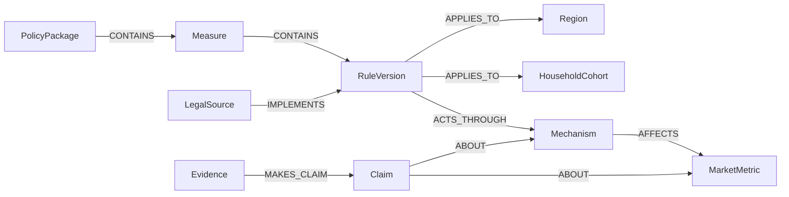

# 데이터 모델

## 1. 모델링 원칙

- 정책 패키지와 실제 적용되는 원자 규칙을 분리한다.
- 규칙 변경은 덮어쓰지 않고 새 버전으로 저장한다.
- 법적 유효시간과 시스템 기록시간을 함께 저장한다.
- 연구 결론은 사실이 아니라 조건부 Claim으로 저장한다.
- 모든 정량값에는 단위와 출처가 필요하다.
- 합성 데이터 식별자는 `demo_`로 시작한다.

## 2. 주요 엔터티

| 엔터티 | 역할 |
| --- | --- |
| `PolicyPackage` | 정부 대책이나 발표 문서 묶음이다. |
| `Measure` | 패키지에 포함된 정책 수단이다. |
| `RuleVersion` | 실제 판정에 사용하는 원자 규칙이다. |
| `LegalSource` | 법령, 고시, 공고와 보도자료이다. |
| `Region` | 유효기간이 있는 행정구역과 지정구역이다. |
| `HouseholdCohort` | 정책 노출과 행동을 계산하는 가구 유형이다. |
| `Mechanism` | 대출 가능액, 세후수익률, 매물과 심리 같은 경로이다. |
| `MarketMetric` | 가격, 거래량, 전세, 매물과 대출 같은 결과이다. |
| `Observation` | 지역과 시점에 연결된 실제 관측값이다. |
| `Evidence` | 논문과 보고서 원문이다. |
| `Claim` | 연구가 제시한 조건부 효과 주장이다. |
| `Scenario` | 기준 정책에 적용할 변경 집합이다. |
| `SimulationRun` | 입력, 데이터, 모형과 결과의 재현 가능한 기록이다. |

## 3. 시간 필드

정책 규칙은 다음 시간을 구분한다.

```text
announced_at
promulgated_at
effective_from
effective_to
grace_period_from
grace_period_to
recorded_from
recorded_to
```

날짜를 알 수 없으면 값을 추측하지 않고 `null`과 불확실성 상태를 저장한다.

## 4. 주요 관계



규칙 사이에는 `AMENDS`, `SUPERSEDES`, `EXEMPTS`와 `INTERACTS_WITH` 관계를 사용한다. 지역 사이에는 `ADJACENT_TO`, `SUBSTITUTE_FOR`와 `SPILLOVER_TO`를 사용한다.

## 5. 정책 규칙 계약

`packages/contracts/policy-rule.schema.json`이 실행 가능한 기준이다. 핵심 필드는 다음과 같다.

- 안정적인 `rule_id`
- 정책 분류와 규제 방향
- 적용 조건과 수치
- 적용 지역 및 대상
- 시행 기간
- 원문 URL과 발췌문
- 검증 상태와 추출 신뢰도

## 6. Claim 계약

Claim은 다음 조건을 포함한다.

```text
policy_type
treated_group
control_group
target_region
sample_period
outcome_metric
effect_direction
effect_value
lower_bound
upper_bound
horizon_months
method
market_regime
evidence_grade
limitations
source_url
```

효과값이 없는 정성 분석도 저장할 수 있지만 정량 시뮬레이션 계수로 사용하지 않는다.

## 7. 완전성 상태

| 상태 | 의미 |
| --- | --- |
| `COMPLETE` | 필수 출처와 규칙 검증을 모두 충족했다. |
| `INCOMPLETE` | 공식 출처 또는 규칙이 누락되었다. |
| `CONFLICTED` | 공식 출처 사이의 충돌이 해결되지 않았다. |
| `DEMO_INCOMPLETE` | 합성 또는 제한된 해커톤 fixture이다. |

## 8. 모형 상태

| 상태 | 의미 |
| --- | --- |
| `VALIDATED` | 백테스트와 보정 조건을 충족했다. |
| `EXPERIMENTAL` | 연구 및 내부 검증 단계이다. |
| `SYNTHETIC_FIXTURE` | 화면과 계약 검증용 합성 결과이다. |
| `UNAVAILABLE` | 신뢰할 수 있는 정량 결과를 만들 수 없다. |

## 9. 소스 우선순위

1. 법령, 시행령, 행정규칙, 고시와 관보
2. 담당 기관의 공식 정책 원문
3. 공공 연구기관의 연구와 통계
4. 금융사와 증권사의 보고서
5. 언론과 비공식 해설

낮은 우선순위의 자료가 높은 우선순위의 법적 상태를 변경해서는 안 된다.
