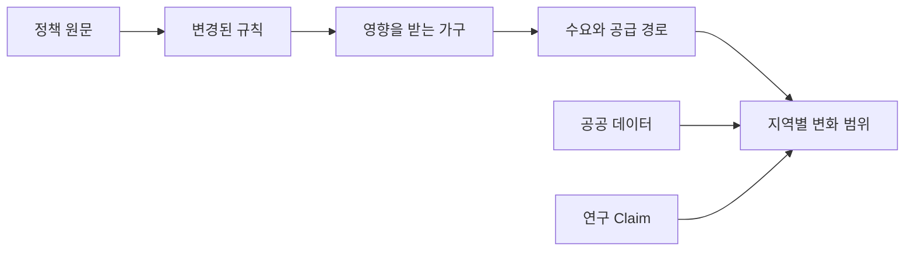

# 최종 발표 시연 기획

## 현재 실행본 (2026-10-16)

실제 발표 순서와 검증 결과는 [SweetHome 실전 데모 실행안](DEMO_RUNBOOK.md)을 우선한다. 아래는 제품의 목표 시연 설계이며, JEV 행동 모형, 자동 전이효과, 전체 정책 결합과 오프라인 결과 캐시 등 아직 연결되지 않은 기능이 포함되어 있다. 현재 가능한 범위를 실행안에서 구분했다.

## 1. 시연 한 문장

최근 정부의 부동산 정책 개편안을 넣으면 PolicyMap이 기존 정책과 달라진 규칙을 읽고, 수도권의 지역별 영향과 가구 유형별 반응을 한 화면에서 시뮬레이션한다.

## 2. 시연 입력

발표에서는 최근 정부가 발표한 부동산 정책 개편안의 공식 원문을 사용한다. 정책명과 원문 파일은 발표 전날 확정하며, 발표 이후 수정되거나 추가된 내용을 임의로 섞지 않는다.

지원할 입력 방식은 다음과 같다.

| 입력 | 처리 방식 | 발표용 우선순위 |
| --- | --- | --- |
| 텍스트 붙여넣기 | 본문을 바로 구조화한다. | 장애 복구용으로 반드시 준비한다. |
| PDF | 텍스트와 표를 추출하고 원문 위치를 보존한다. | 기본 시연 입력으로 사용한다. |
| HWPX | 문서 XML에서 본문과 표를 추출한다. | 공식 배포본이 HWPX일 때 사용한다. |
| HWP | 변환 어댑터로 본문을 추출한다. 실패하면 같은 내용의 PDF 또는 텍스트로 전환한다. | 지원하되 기본 시연 경로로 의존하지 않는다. |

화면에는 파일명, 공식 출처, 발표일, 문서 해시와 추출 상태를 표시한다. 업로드한 문서의 모든 문장을 확정된 법적 사실로 취급하지 않고, 검증된 규칙과 검토가 필요한 후보를 구분한다.

## 3. 발표용 골든 패스

### 장면 1: 정책 문서를 넣는다

첫 화면 중앙에 큰 문서 입력 영역을 둔다. 발표자는 PDF 또는 한글 파일을 끌어다 놓거나 정책 본문을 붙여넣는다.

입력 직후 다음 처리 상태를 5초에서 8초 안에 순서대로 보여준다.

1. 정책 문서를 읽고 있다.
2. 기존 정책과 달라진 규칙을 찾고 있다.
3. 적용 지역과 가구를 연결하고 있다.
4. 근거와 시뮬레이션 조건을 확인하고 있다.

처리 상태에는 실제 완료한 작업만 표시한다. 발표용 샘플은 사전에 추출하고 캐시할 수 있지만, 화면에는 `발표용 검증 스냅샷 사용` 상태를 공개한다.

### 장면 2: 무엇이 바뀌었는지 확인한다

긴 요약문 대신 정책 변경 카드를 먼저 보여준다. 각 카드는 다음 정보를 포함한다.

- 변경 종류: 신규, 강화, 완화, 연장, 종료 또는 대체
- 이전 규칙과 새 규칙
- 발표일과 시행일
- 적용 지역과 대상 가구
- 예외와 유예 조건
- 원문의 해당 문장과 위치
- 검증 상태

발표에서는 영향이 큰 변경 3개만 펼쳐 보여주고, 나머지는 `추가 변경점`으로 접는다. 사용자가 `시뮬레이션 실행`을 누르면 정책 차이 상태가 지도와 페르소나의 공통 입력이 된다.

### 장면 3: 수도권 지도가 변한다

시뮬레이션 화면이 열리면 수도권 지도가 먼저 나타난다. 서울, 경기와 인천의 시군구를 동일한 행정구역 기준으로 표시한다.

지도에는 단순한 상승 및 하락 색상만 쓰지 않고 다음 정보를 함께 표현한다.

- 색상: 예상 가격 변화 범위의 중앙값
- 색의 투명도: 근거 적합성과 모형 신뢰도
- 외곽선: 정책이 직접 적용되는 지역
- 파동 애니메이션: 인접 지역으로 이동하는 수요와 전이 가능성
- 지역 라벨: 변화 범위와 가장 큰 작동 경로
- 시간 선택: 발표 직후, 3개월, 6개월과 12개월

지역을 선택하면 `왜 이 지역이 변했는가` 패널이 열린다. 예를 들어 대출 가능액 감소, 매수 수요 이동, 거래량 감소와 인접 지역 전이처럼 정책 변경부터 결과까지 이어지는 경로를 표시한다.

### 장면 4: 페르소나가 동시에 반응한다

지도 오른쪽에는 JEV 기반 가구 유형을 세로 카드로 배치한다. 지도 결과가 나타날 때 카드도 동시에 등장하여 정책이 평균 가격뿐 아니라 실제 선택에 어떤 차이를 만드는지 보여준다.

발표용 기본 페르소나는 다음 네 유형으로 제한한다.

| 페르소나 | 핵심 상태 | 보여줄 반응 |
| --- | --- | --- |
| 무주택 신혼부부 | 소득, 현금, 정책대출 자격 | 구매 가능 지역, 대출 가능액과 대기 확률 |
| 고DSR 실수요자 | 기존 부채, 소득과 목표 지역 | 구매 가능액 감소와 관망 확률 |
| 1주택 갈아타기 가구 | 기존 주택, 매도 계획과 추가 대출 | 이동 지역과 매도 지연 가능성 |
| 현금 비중이 높은 다주택자 | 현금, 보유 주택과 세금 노출 | 매수, 매도, 증여와 유지 확률 |

각 카드는 `정책 전`과 `정책 후`의 변화를 비교한다. 자유로운 대화문이나 감정 연기보다 구매 가능액, 선택 지역과 행동 확률처럼 비교 가능한 상태를 우선한다. 카드를 선택하면 관련 지역이 지도에서 강조된다.

### 장면 5: 결과의 근거를 연다

마지막에는 지도에서 변화가 큰 지역 하나를 선택하고 근거 패널을 연다. 다음 연결이 한 번에 보여야 한다.

수치는 단일 예측값이 아니라 범위로 표시하고, 합성 자료나 검증되지 않은 계수가 있으면 화면에 고정해서 알린다.

## 4. 시뮬레이션 화면 구성

데스크톱 발표 화면은 다음 비율을 기준으로 한다.

| 영역 | 화면 비중 | 내용 |
| --- | --- | --- |
| 상단 정책 바 | 높이 12% | 정책명, 시행일, 핵심 변경점과 신뢰 상태 |
| 수도권 지도 | 너비 60% | 지역별 가격 및 거래량 변화, 직접 적용 지역과 전이효과 |
| 페르소나 패널 | 너비 28% | 가구별 구매력, 선택 지역과 행동 변화 |
| 하단 원인 패널 | 높이 25% | 선택한 지역의 정책부터 결과까지 이어지는 경로와 근거 |

지도와 페르소나는 별도 페이지로 분리하지 않는다. 발표자가 한 화면에서 지역 변화와 사람의 반응을 연결해 설명할 수 있어야 한다.

## 5. 3분 발표 흐름

| 시간 | 발표 내용 | 화면 |
| --- | --- | --- |
| 0:00부터 0:20 | 정책이 자주 바뀌고 여러 규칙이 동시에 작동한다는 문제를 설명한다. | 문서 입력 화면 |
| 0:20부터 0:50 | 최근 정책 개편안 파일을 넣고 변경 규칙을 추출한다. | 처리 상태와 정책 변경 카드 |
| 0:50부터 1:45 | 수도권 지도에서 직접효과, 시간 변화와 인접 지역 전이를 보여준다. | 지도 중심 시뮬레이션 화면 |
| 1:45부터 2:20 | 서로 다른 가구가 같은 정책에 다르게 반응하는 모습을 보여준다. | 페르소나 카드와 지도 연동 |
| 2:20부터 2:45 | 한 지역을 선택해 정책 원문, 데이터와 연구 근거를 추적한다. | 원인 및 근거 패널 |
| 2:45부터 3:00 | 정확한 예언이 아니라 검증 가능한 정책 실험 도구라는 가치를 정리한다. | 신뢰 상태와 핵심 한 문장 |

## 6. 발표용 데이터 준비

발표 전날 다음 자료를 하나의 버전으로 고정한다.

1. 정부 또는 담당 기관의 공식 정책 원문
2. 이전 정책 스냅샷과 변경된 원자 규칙
3. 수도권 행정구역 경계와 지역별 기준 관측값
4. 적용 가능한 연구 Claim과 사용하지 않은 Claim의 사유
5. 네 가지 페르소나의 기준 상태
6. 시뮬레이션 결과와 불확실성 범위
7. 각 결과에서 원문까지 돌아갈 수 있는 출처 연결

정책 원문이 발표 직전에 바뀌면 새 수치를 즉시 만들어내지 않는다. 변경된 문서라는 사실을 알리고 검증된 이전 스냅샷을 시연한다.

## 7. 장애 복구 경로

- PDF 또는 HWP 추출이 실패하면 같은 정책의 검증된 텍스트를 붙여넣는다.
- Gemini 응답이 지연되면 사전에 검증한 추출 결과를 불러오고 캐시 사용 상태를 표시한다.
- 실시간 시뮬레이션이 실패하면 같은 입력과 버전으로 저장한 결과를 불러온다.
- 지도 타일 네트워크가 끊겨도 로컬 수도권 경계와 기본 배경으로 시연한다.
- 모든 복구 경로에서도 출처, 데이터 상태와 모형 상태를 숨기지 않는다.

## 8. 완료 기준

- 텍스트와 PDF 입력이 실제로 동작한다.
- HWPX 또는 HWP 가운데 최소 한 형식이 동작하고, 실패 시 텍스트 대체 경로가 있다.
- 입력 후 정책 변경점이 8초 안에 나타난다.
- 지도와 페르소나가 같은 `scenario_id`를 사용한다.
- 지역을 선택하면 변화의 주요 원인과 근거가 표시된다.
- 페르소나를 선택하면 연관 지역이 지도에서 강조된다.
- 발표용 샘플은 네트워크가 끊겨도 끝까지 시연할 수 있다.
- 합성 자료, 캐시와 검증되지 않은 근거가 화면에서 명확히 구분된다.
