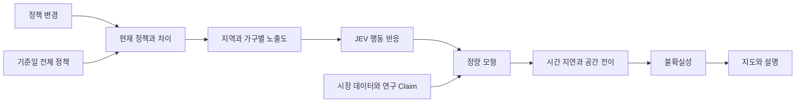

# PolicyMap 제품 기획

## 1. 제품 정의

PolicyMap은 특정 날짜와 지역에 적용된 한국 부동산 정책을 전부 복원하고, 정책 변경이 가구 행동과 지역별 가격 및 거래량에 미치는 경로를 설명하는 서비스이다.

가격을 직접 맞히는 서비스보다 정책 상태와 근거를 검증할 수 있는 의사결정 도구를 지향한다.

## 2. 해결하려는 문제

한국 부동산시장에는 금융, 세금, 거래, 공급, 정비사업, 임대차와 지역 지정 정책이 동시에 적용된다. 정책 발표일과 시행일이 다르고 예외 및 유예 조건도 복잡하다. 일부 정책만 골라 가격과 연결하면 누락된 정책의 효과를 잘못 귀속할 수 있다.

사용자는 다음 질문에 답하기 어렵다.

- 지금 내 지역에 적용되는 정책은 무엇인가?
- 새로운 대책으로 실제로 달라지는 규칙은 무엇인가?
- 정책이 가격까지 이어지는 중간 경로는 무엇인가?
- 가구 유형별로 구매 가능액과 행동이 어떻게 달라지는가?
- 인접 지역에 수요가 이동하는가?
- 결과는 어떤 데이터와 연구에 근거하는가?
- 분석에서 빠진 정책은 없는가?

## 3. 제품 원칙

### 정책 원장이 먼저이다

MVP 기능은 줄일 수 있지만 정책 원장을 임의로 줄인 상태에서 신뢰 가능한 결론을 주장하지 않는다.

### 기준 상태와 변경 상태를 비교한다

기준일의 전체 정책 상태를 `S0`, 사용자가 제안한 변경 상태를 `S1`로 구성한다. 두 상태에서 동일한 시장 조건을 사용하고 결과 차이를 정책 변화 효과로 계산한다.

### 정책과 근거의 완전성을 분리한다

모든 정책을 수집했더라도 효과를 측정한 연구가 없을 수 있다. 정책 완전성, 데이터 완전성, 근거 적합성과 모델 신뢰도를 별도로 표시한다.

### 연구 결과는 Claim으로 보존한다

연구마다 지역, 기간, 방법과 시차가 다르다. 상반된 결과를 덮어쓰거나 단순 평균내지 않는다.

### LLM이 숫자를 만들지 않는다

Gemini는 정책 문서를 구조화하고 유사 사례를 찾고 결과를 설명한다. 가격과 거래량의 정량값은 명시적인 계산식, 검증된 연구 계수 또는 백테스트를 거친 통계 모형이 계산한다.

## 4. 정책 전수 수집 범위

분석 기준일과 지역에 대해 다음 영역의 유효한 규칙을 전부 포함한다.

| 영역 | 범위 |
| --- | --- |
| 금융 | LTV, DTI, DSR, 대출 한도, 전세대출, 정책모기지와 중도금대출 |
| 조세 | 취득, 보유, 양도, 임대소득과 증여 관련 규칙 |
| 거래 | 규제지역, 토지거래허가구역, 실거주, 전매와 신고 의무 |
| 공급 | 택지, 인허가, 분양가, 청약, 공공주택과 입주 일정 |
| 정비사업 | 재건축, 재개발, 안전진단, 초과이익환수와 용적률 |
| 임대차 | 계약갱신, 임대료, 임대사업자, 보증과 전월세 신고 |
| 지역 | 조례, 정비계획, 용도지역, 개발계획과 지역별 예외 |
| 거시건전성 | 기준금리와 주택금융에 직접 적용되는 조치 |
| 지원 | 생애최초, 청년, 신혼부부, 다자녀와 실수요자 지원 |

## 5. 완전성 계약

정책 스냅샷은 다음 조건을 모두 충족해야 `COMPLETE`가 된다.

- 필수 기관과 공식 출처의 수집 작업이 성공했다.
- 정책 패키지를 원자 규칙으로 분해했다.
- 각 규칙에 시행일, 적용 지역, 대상과 원문이 있다.
- 변경, 대체, 종료, 예외와 유예 관계를 연결했다.
- 상충하는 공식 자료를 해결하거나 미해결 상태로 공개했다.
- 지역 지정과 법령 상태가 기준일에 일치한다.

`COMPLETE`가 아니면 실제 예측을 차단한다. 데모 모드에서는 합성 자료라는 표시와 누락 상태를 항상 보여준다.

## 6. 사용자

| 사용자 | 요구 |
| --- | --- |
| 일반 가구 | 정책이 대출 가능액과 주거 선택에 미치는 영향을 이해한다. |
| 정책 담당자 | 직접효과, 부작용과 지역 전이효과를 점검한다. |
| 금융기관 | 지역별 주택시장과 대출 수요 변화를 분석한다. |
| 연구자와 언론 | 정책 시행 전후의 시장 변화와 근거를 추적한다. |

## 7. 핵심 사용자 경험

### 정책 시나리오 입력

사용자는 정책 본문을 붙여넣거나 PDF, HWPX와 HWP 파일을 업로드한다. Gemini는 추출된 본문에서 원자 규칙 후보를 만들고 현재 정책 스냅샷과 비교한다. 사용자는 적용 지역, 대상, 시행일과 예외를 확인한 뒤 시나리오를 실행한다. 파일 추출이 실패하면 같은 정책의 텍스트를 붙여넣을 수 있어야 한다.

### 정책 변경 확인

서비스는 현재 규칙과 제안 규칙을 비교하여 신규, 강화, 완화, 연장, 종료, 대체를 표시한다.

### 결과 지도

수도권 지도에 지역별 가격 및 거래량 범위, 직접효과, 전이효과와 신뢰도를 표시한다. 시간 선택으로 발표 직후부터 12개월까지의 반응을 확인한다. 정책이 직접 적용되는 지역과 인접 지역으로 수요가 이동할 가능성을 시각적으로 구분한다.

### 원인 분해

대출 가능액, 세후수익률, 매수 및 매도 행동, 기대심리, 공급과 수요 이동을 분리해 보여준다.

### 가구 반응

무주택 신혼부부, 고DSR 실수요자, 1주택 갈아타기 가구와 현금 비중이 높은 다주택자의 반응을 비교한다. 지도 옆에 페르소나 카드를 동시에 표시하고, 카드를 선택하면 관련 지역과 작동 경로를 강조한다.

### 근거 확인

결과를 선택하면 정책 원문, 유사한 과거 정책, 연구 방법, 적용 범위, 상반된 연구와 한계를 확인한다.

## 8. 주요 화면

1. 홈: 정책 텍스트 또는 파일 입력과 기준일 선택
2. 정책 차이: 변경 전후 규칙, 시행일, 예외와 충돌 확인
3. 통합 시뮬레이션: 수도권 지도, 시간 변화와 페르소나 반응
4. 원인 분해: 정책부터 결과까지 인과 경로
5. 근거 패널: 연구, 데이터, 한계와 원문
6. 완전성 대시보드: 기관별 수집 상태와 누락 규칙

## 9. 시뮬레이션 개요

### JEV의 역할

JEV는 자유로운 대화형 페르소나가 아니라 구조화된 가구 및 시장 참여자 행동 모형으로 사용한다. 소득, 자산, 부채, 현금 비중, 주택 수, 기대심리와 위험 선호를 상태로 보유하고 매수, 매도, 증여, 임대와 관망 확률을 계산한다.

### 결과 범위

단일 값 대신 중앙값과 50% 및 80% 범위를 제공한다. 정책 완전성, 데이터 결측, 연구의 외적 타당성과 모델 계수 오차를 범위에 반영한다.

## 10. 신뢰도

전체 신뢰도는 다음 항목을 분리해 보여준다.

- 정책 완전성
- 데이터 완전성
- 근거 적합성
- 모델 재현성

한 항목이 낮으면 전체 신뢰도를 높게 표시하지 않는다.

## 11. 해커톤 시연 범위

해커톤에서는 전체 정책 원장이 완성되었다고 주장하지 않는다. 다음 핵심 구조를 시연한다.

- 최근 정부의 부동산 정책 개편안 원문을 텍스트, PDF 또는 한글 파일로 입력한다.
- 정책 문서를 원자 규칙으로 분해한다.
- 검증된 데모 정책 스냅샷을 조회한다.
- 정책 변경 전후 차이를 보여준다.
- 수도권 지도와 JEV 기반 페르소나를 한 화면에 표시한다.
- 지도와 인과 그래프로 직접효과, 전이효과와 시간 변화를 보여준다.
- 결과를 정책 원문과 연구 근거에 연결한다.
- 데모 데이터의 불완전성을 화면에 고정 표시한다.

발표에 사용할 정책 원문과 추출 결과는 발표 전날 검증된 버전으로 고정한다. 현장에서는 문서 입력부터 결과 화면까지의 흐름을 시연하되, 외부 서비스가 지연되면 동일한 입력과 버전으로 미리 검증한 결과를 사용하고 캐시 상태를 표시한다.

상세한 화면과 발표 흐름은 [최종 발표 시연 기획](FINAL_DEMO.md)을 따른다.

## 12. 출시 조건

- 대상 범위의 정책 스냅샷이 `COMPLETE`이다.
- 결과에 영향을 준 모든 규칙을 원문에서 추적할 수 있다.
- 정량값이 검증된 모형이나 명시적인 계산식에서 나온다.
- 예측 구간이 과거 정책 백테스트에서 보정되었다.
- 실패 사례와 적용 불가능한 지역을 함께 공개한다.
- 동일한 입력과 데이터 및 모델 버전으로 결과를 재현할 수 있다.
